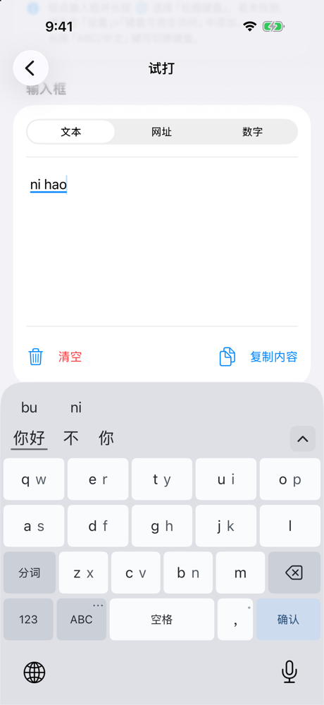
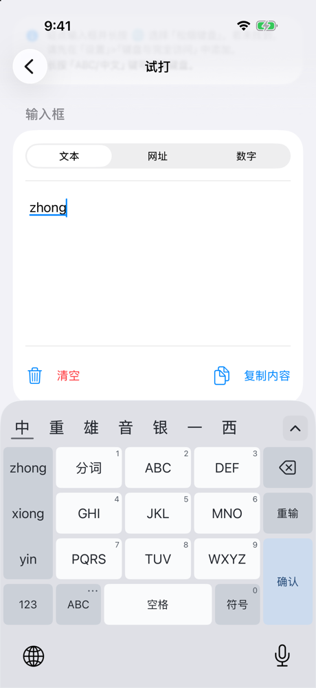
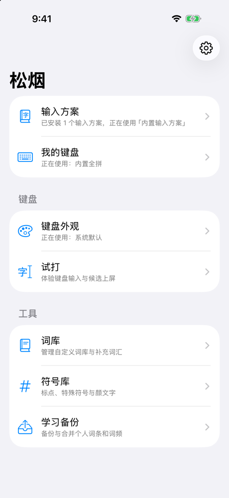

# Songyan (松烟)


[简体中文](README.zh-CN.md)

Songyan is a general-purpose Chinese keyboard for iOS built on the
[RIME](https://rime.im) input method engine. It ships a host app for managing
input schemes and a keyboard extension that runs the engine on device.

<p>
  
  
  
</p>

## Features

- RIME engine (librime 1.17) with the `lua`, `octagram` (grammar model) and
  `predict` plugins, running inside the keyboard extension.
- Two built-in input schemes, full pinyin and Xiaohe (flypy) double pinyin,
  on four layouts: 26, 14, 18 and 9 keys. The 14-, 18- and 9-key variants of
  each scheme are generated from it.
- On merged keys, swipe sideways to type either letter; optional double pinyin
  hints on the letter keys.
- Import RIME schemes and dictionaries from files or URLs; enable, disable or
  remove them from the host app.
- Customizable appearance, candidate bar and key layouts, with a built-in
  typing preview.
- Optional typo correction, post-commit prediction (bring your own
  `predict.db`), grammar models, and per-component Lua toggles.
- Manual backup and merge of learned user dictionaries.
- The keyboard extension makes no network requests. The host app goes online
  only when you ask it to: importing or updating a scheme from a URL, or
  downloading a dictionary or model file. Full Access is used to share data
  with the host app through the App Group.

## Requirements

- macOS with Xcode 27 or later (iOS 27 SDK or newer); the app runs on iOS 17.0 and later.
- An Apple silicon Mac to run on the simulator: the engine ships only an arm64
  simulator slice.
- Python 3.11 or later for the project scripts and tests (standard library
  only).

The prebuilt engine, `Packages/RimeBridge/Vendored/RimeKit.xcframework`, is
committed, so building the app does not require compiling librime.

## Getting started

1. Clone the repository and open `Songyan.xcodeproj`.
2. To run on a simulator, use `make sim-stage`. It builds Debug, signs it ad
   hoc so the App Group works without a developer account, and installs it on
   a dedicated simulator. See [DEBUG.md](DEBUG.md).
3. To run on a device, create `Config/Local.xcconfig` (it is ignored by Git)
   and set `DEVELOPMENT_TEAM` to your team. If the default identifiers are
   taken, override them as well:

   ```
   DEVELOPMENT_TEAM = ABCDE12345
   SONGYAN_BUNDLE_ID = com.example.songyan
   SONGYAN_APP_GROUP = group.com.example.songyan
   ```

   The keyboard extension's bundle id is derived as `$(SONGYAN_BUNDLE_ID).keyboard`.
4. Build and run the `HostApp` scheme, then enable the keyboard in
   Settings → General → Keyboard → Keyboards, and turn on Full Access.

## Development

| Command | Purpose |
| --- | --- |
| `make fast` | Structure checks, Swift package tests and offline probes |
| `make lint` / `make format` | Check / apply Swift, shell and Python formatting |
| `make extended` | `fast` + native engine harnesses + Debug builds for simulator and device |
| `make release` | `extended` + installed engine check + Release builds |
| `make sim-stage` | Build, install and launch on a dedicated simulator |

CI runs the lint checks, the `make fast` tests and unsigned Debug and Release
builds for simulator and device on every pull request.

See [CONTRIBUTING.md](CONTRIBUTING.md) for the workflow,
[ARCHITECTURE.md](ARCHITECTURE.md) for the module map, and
[DEBUG.md](DEBUG.md) for debugging and simulator automation.

## Rebuilding the engine

`Tools/BuildRime` (macOS) and `Tools/BuildRimeIOS` (iOS slices) build librime
and its plugins from pinned upstream sources.
`Tools/BuildRimeIOS/scripts/43-build-rimekit.py` builds the XCFramework, and
`Tools/BuildRimeIOS/scripts/export-rimekit.py` installs it and records its
checksums in `Packages/RimeBridge/RimeKitArtifact.json`. Upstream versions are
pinned in `Tools/BuildRime/VERSIONS.env`.

## Known issues

- **Extra 17 pt gap above the keyboard (iOS 26 and 27 bug).** After switching
  apps with the keyboard up, or switching to Songyan from a system keyboard
  with a top bar (English, Pinyin), iOS can add a blank 17 pt strip above any
  third-party keyboard. The extension's own frame and safe area don't change,
  so it can't detect or undo this. The strip stays until you switch to the
  Emoji keyboard and back, or quit and reopen the app you're typing in. Tracked
  in the
  [Apple Developer Forums](https://developer.apple.com/forums/thread/843093)
  (FB24460699, FB25094825). Until Apple fixes it, Songyan's candidate area is
  10 pt shorter so the keyboard doesn't look too tall when the strip appears.

## License

Copyright © 2026 Suzukaa-a. Songyan is licensed under the
[GNU General Public License, version 3 only](LICENSE) (GPL-3.0-only).

Third-party components and their licenses are listed in
[Resources/Legal/ThirdPartyNotices.txt](Resources/Legal/ThirdPartyNotices.txt).
